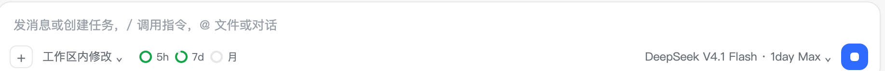

# dsh-plugin-opencode-quota

<sub><a href="README.md">中文</a> | English</sub>

A [DeepSeek Harness](https://github.com/deepseek-ai) (DSH) plugin that shows the remaining **OpenCode Go** allowance in the composer toolbar.

[](LICENSE)


<p align="center">
  
</p>

## Install

The plugin ships as a local DSH bundle:

1. Clone or copy this repository anywhere on disk.
2. In DSH, open **Plugins → Add plugin** and pick this directory.
3. Return to the chat: an allowance chip appears in the composer tool row, right after the permission control.

To install it for the whole profile instead, add this row to the profile's `cordis.patch.yml` (not this package's file). The row id must be `opencode-quota`:

```yaml
- insert:
    - id: opencode-quota
      name: 'dsh-plugin-opencode-quota'
      config: {}
```

The bundle ships the same content in its own `cordis.patch.yml`, so **Add plugin** already inserts it; write it by hand only when you want the row in your own patch layer. Set `disabled: true` on that row to switch the plugin off without uninstalling.

## Requirements

- DSH 0.2.x (uses the `web` client platform and the `shell.overlay` slot).
- An OpenCode Go API key — see below.

## What it shows

The allowance comes from the OpenCode endpoint `GET https://opencode.ai/zen/go/v1/usage`, read with the API key you configured in DSH. It returns three windows:

| Window | Key |
|:--|:--|
| 5-hour | `rolling` |
| 7-day | `weekly` |
| Monthly | `monthly` |

OpenCode reports the **used** percentage (`percent`); the plugin renders the **remaining** share. The toolbar button draws the three windows as small rings (a full ring = 100% left, green / amber / red for how tight it is, and a dot when a window hits 0% so it stays visible), each tagged `5h` / `7d` / `1m`. Hover for exact percentages; click to open a dialog with per-window remaining bars, the window status (`ok` / `rate-limited`) and the reset time.

## Where the key comes from

The plugin never stores or displays the key:

1. It reads the OpenCode provider routes configured in DSH (`opencode-go`).
2. Each route maps to a credential reference (`OPENCODE_GO_API_KEY`), resolved through the DSH credential store — a key you entered in **Settings → Models → third-party providers**, an environment variable, or a `.env` file.
3. The key stays inside the Host process; the browser half never sees it.

So: configure an OpenCode key in **Settings → Models** and the chip starts reporting. Without a key the chip reads "no key" and the dialog explains where to add one.

## Usage

- The allowance refreshes every 60 seconds (one HTTP call, with a 45-second Host-side cache).
- Click the chip for the detail dialog, which has a manual **Refresh**.
- Remaining ≤ 20% turns amber, ≤ 5% turns red.
- Close the dialog with its button, `Esc`, or a click outside it.

## Limitations

- Only plans that expose allowance windows are supported (`opencode-go`). OpenCode Zen's pay-as-you-go credits are not available to API keys; check [the OpenCode console](https://opencode.ai/console) under Overview → Credits — the plugin says "see console" in that case.
- Figures come from the OpenCode API as-is. `401`/`403` means the key was rejected; timeouts and network errors are explained in the dialog.
- The plugin registers no model-facing tools and writes nothing to the session log.

## Companion plugin

This plugin shows **OpenCode allowance only**. Today's token consumption is shown by [`dsh-plugin-daily-tokens`](https://github.com/mi2466172099/dsh-plugin-daily-tokens) beside the window traffic lights — the OpenCode API does not return token counts, so that figure comes from the local session logs.

## Development

After changing **`client.js`**, reload the page. After changing **`index.js`**, open **Plugins**, switch the row off and back on (no app restart needed): the Host half is not hot-reloaded.

## License

MIT — see [LICENSE](LICENSE).
