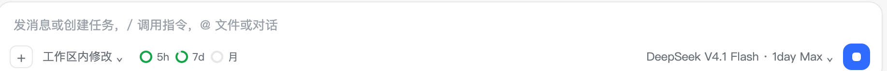

# dsh-plugin-opencode-quota

在 [DeepSeek Harness](https://github.com/deepseek-ai)（DSH）的输入框工具栏显示 **OpenCode Go** 的剩余额度。

  

## 安装

DSH 的插件以本地 bundle 形式安装：

1. 把本仓库放到任意目录；
2. 打开 DSH → **插件** → **添加插件**，选择这个目录；
3. 回到聊天页，输入框工具行（「工作区内修改 ⌄」之后）会出现额度胶囊。

若想装给整个 profile 而不是单个会话，也可以在 `cordis.patch.yml` 里以自己的 `insert` 行引用本包（行 id 用 `opencode-quota`）。

## 要求

- DSH 0.2.x（`dsh.client` 的 `platform: web` 与 `shell.overlay` 插槽）。
- 一个可用的 OpenCode Go API 密钥（见下文「密钥从哪里来」）。

## 显示的内容

额度来自 OpenCode 官方接口 `GET https://opencode.ai/zen/go/v1/usage`，使用你在 DSH 里配置的 OpenCode API 密钥读取，返回三档窗口：

| 窗口 | 含义 |
|:--|:--|
| 5 小时 | 滚动 5 小时窗口（`rolling`） |
| 7 天 | 每周窗口（`weekly`） |
| 月度 | 每月窗口（`monthly`） |

接口返回的是**已用百分比**（`percent`），插件把它换算成**剩余百分比**显示。

工具栏按钮位于输入框工具行、紧跟“工作区内修改 ⌄”，把三档窗口画成三个小圆环（整圈 = 剩余 100%，绿 / 橙 / 红表示紧张程度；0% 时保留一个圆点以便仍能看见），旁边是窗口短标签 `5h` `7d` `月`。悬停可看精确百分比，点击打开弹窗，里面有每档**剩余量进度条**、窗口状态（正常 / `已限流`）与重置时间。

## 密钥从哪里来

插件不保存密钥，也不读取你的配置文件：

1. 读取当前 DSH 配置中已启用的 OpenCode 提供商路由（`opencode-go`）；
2. 按该路由推导凭证引用 `OPENCODE_GO_API_KEY`，通过 Host 凭证服务解析（“设置 → 模型 → 第三方模型提供商”里填入的密钥、或环境变量、或 `.env`）；
3. 密钥只在 Host 进程内使用，浏览器端拿不到明文。

所以：**在“设置 → 模型”里给 OpenCode 填好 API 密钥，胶囊就会显示额度**。没填密钥时胶囊显示“未填密钥”，弹窗里会提示去设置页填写。

## 使用

- 额度每 60 秒刷新一次（只调 OpenCode 接口，Host 侧另有 45 秒缓存）。
- 点击胶囊打开详情弹窗，可手动“刷新”。
- 剩余 ≤ 20% 转警告色，≤ 5% 转错误色。
- 关闭弹窗：右上角关闭按钮、`Esc`、或点击弹窗外区域。

## 限制

- 只支持能返回额度窗口的 OpenCode 计划（`opencode-go`）。OpenCode Zen 的按量付费额度**不对 API 密钥开放**，只能在 [OpenCode 控制台](https://opencode.ai/console) 的 Overview → Credits 查看，插件在这种情况下显示“见控制台”。
- 额度数字以 OpenCode 接口为准；接口 401/403 表示密钥无效，超时或网络错误会在弹窗中说明。
- 插件不注册任何模型可调用的工具，也不写入会话记录。

## 配套插件

本插件只显示 **OpenCode 额度**。DSH 当日的 token 消耗由另一个插件 `dsh-plugin-daily-tokens` 显示在窗口左上角红绿灯旁——OpenCode 官方接口不返回 token 数，那部分只能靠本机会话日志统计。

## 开发提示

改了本插件后：**客户端** `client.js` 刷新页面即可生效；**Host** `index.js` 不会随文件变化热更新，需要去「插件」页把这一行关掉再打开（无需重启应用）。

## 许可证

MIT，见 [LICENSE](LICENSE)。
